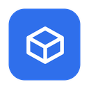
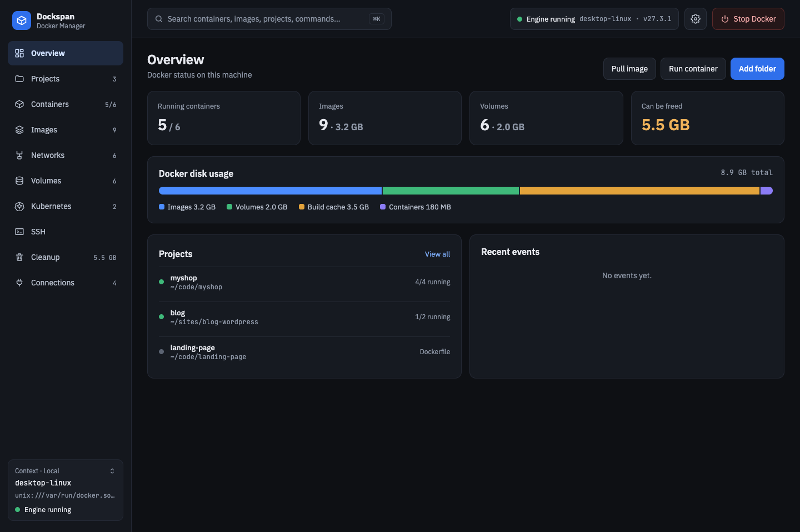
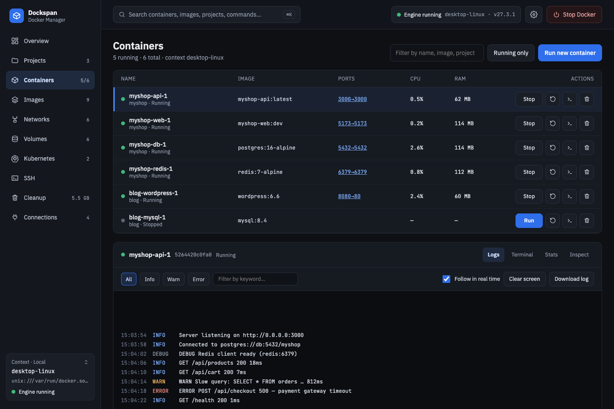
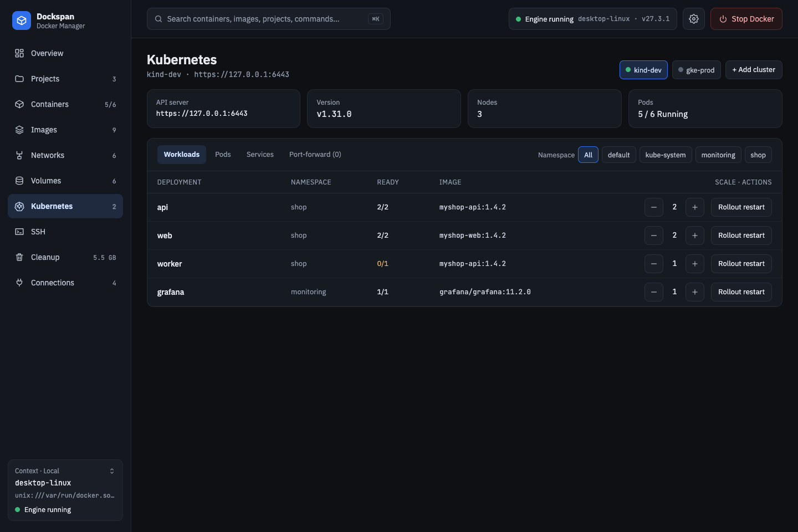
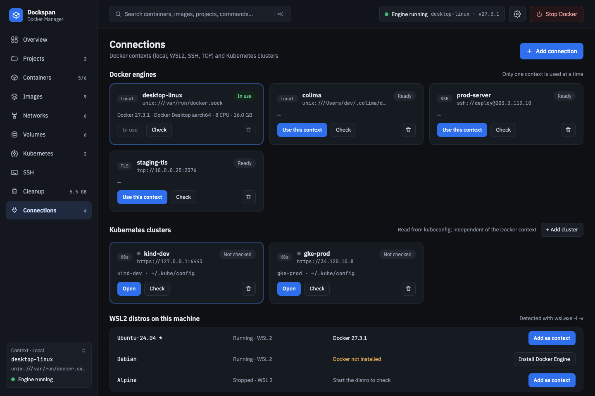
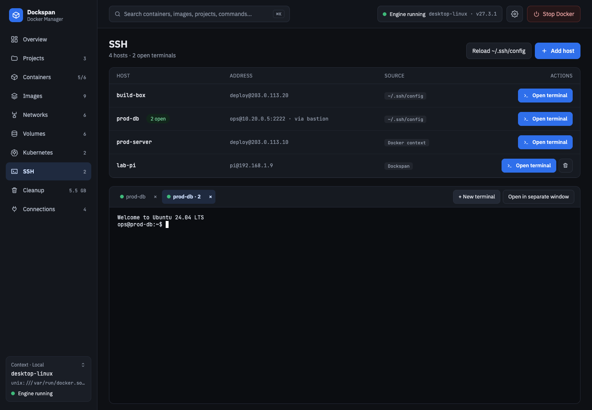
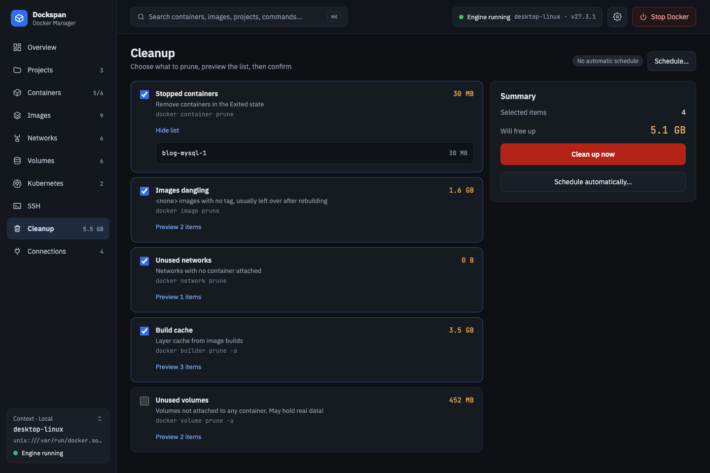
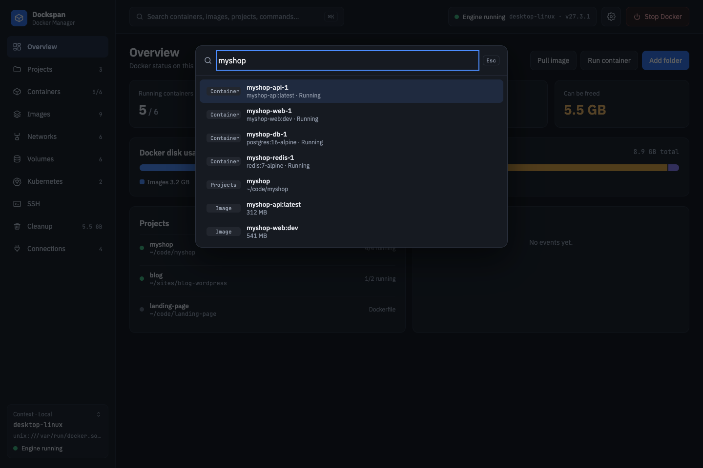

<div align="center">

<!-- TODO: replace with a proper logo (this is the current app icon) -->


# Dockspan

**A fast desktop manager for Docker & Kubernetes, built around your project folders.**

[](LICENSE)
[](https://github.com/phanlyhuynh/dockspan/releases)

[](https://github.com/phanlyhuynh/dockspan)

[Download](#installation) · [Features](#features) · [Docs](docs/connections.md) · [Contributing](CONTRIBUTING.md) · [Tiếng Việt](README.vi.md)



</div>

## Why Dockspan?

- **Project-first.** Add a folder with a Compose file or Dockerfile and manage it as one unit: up, stop, restart, down, edit files.
- **Docker + Kubernetes in one app.** Containers, images, volumes and your kubeconfig clusters side by side.
- **Shares your docker contexts.** Connections are real docker contexts, so the `docker` CLI sees them too.
- **Any engine.** Local socket, SSH, TCP+TLS and WSL2.
- **Lightweight.** Tauri + Rust instead of a bundled browser; no heavy background services.
- **Secrets stay in Rust.** The webview never touches the socket or your kubeconfig; `.env` values are masked.

## Features

### Docker



- **Projects:** add or detect Compose projects, `compose up/stop/restart/down`, browse and edit files; `.env` hides sensitive values.
- **Containers:** create, start, stop, restart, delete; realtime logs filtered by level, xterm.js terminals, stats, inspect.
- **Images:** pull with progress, build, layer history, delete.
- **Networks & Volumes:** browse, with volume backup and restore.
- **Engine control:** start/stop the engine per operating system, and a banner when the connection is lost.

### Kubernetes



- Clusters from your kubeconfig (never modified), independent of the Docker engine.
- Deployments (scale, rollout restart), Pods (logs, exec terminal, plain-language failure explanations), Services and port-forward.
- Lists update through watches, not polling.

<details><summary>More details</summary>

See [docs/kubernetes.md](docs/kubernetes.md): namespaces and 403 fallback, exec auth plugins (gcloud, aws, kubelogin), port-forward behaviour.

</details>

### Connections & SSH



- Add Docker engines over SSH (hosts from `~/.ssh/config`), TCP+TLS or WSL2, and switch between them in one click.
- WSL2 distros are listed with their Docker version, with one-click Docker Engine install.

<details><summary>More details</summary>

See [docs/connections.md](docs/connections.md): docker contexts, the SSH/WSL2 bridge, TLS files, the SSH page.

</details>

### SSH terminals



- A dedicated **SSH page**, independent of Docker: hosts from `~/.ssh/config`, SSH Docker contexts and hosts you add in the app.
- Any number of terminal tabs per host, running the system `ssh` in a real pseudo-terminal, so password prompts, host-key questions, vim/htop and resizing work.
- Terminals survive changing page, can be moved to a separate window, and an ended session offers **Reconnect**.

<details><summary>More details</summary>

See [docs/connections.md](docs/connections.md#ssh-page).

</details>

### Cleanup



- Preview exactly what would be removed before anything is deleted, then clean up on demand or on an automatic schedule.
- A network or volume counts as "in use" if any container, even a stopped one, references it.

### Everything else



- **⌘K / Ctrl+K command palette** to jump to any container, image, project or command.
- **English and Vietnamese UI**, switched live from the gear button (Settings) in the header.

## Installation

<!-- TODO: no GitHub Releases published yet. Add links/badges per OS when the first release exists. -->

Download the latest build from [GitHub Releases](https://github.com/phanlyhuynh/dockspan/releases) (TODO: macOS `.dmg`, Windows `.msi`/`.exe`, Linux `.deb`/`.AppImage`; Homebrew/winget not set up).

**Build from source** (Node 20+, pnpm, Rust, Docker and the [Tauri prerequisites](https://tauri.app/start/prerequisites/)):

```bash
pnpm install
pnpm tauri dev      # run the app
pnpm tauri build    # package it
```

## Quick start

1. Start Docker (or let Dockspan do it with **Start Docker Engine** when it is stopped). Pick an engine on **Connections** if you use more than the local one.
2. Click **Add folder** and choose a project with a `docker-compose.yml` or `Dockerfile`.
3. Use **Start** on the project, then open **Containers** to watch logs or open a terminal.
4. Press **⌘K** any time to search; open **Cleanup** to preview what can be freed.

## Roadmap

- ✅ Docker over local socket / named pipe, SSH, TCP (+TLS), WSL2
- ✅ Overview, Projects (Compose), Containers, Images, Networks, Volumes
- ✅ Cleanup with preview and automatic schedule
- ✅ Kubernetes: Deployments, Pods, Services, port-forward
- ✅ SSH page with terminals, ⌘K palette, English/Vietnamese
- ⬜ Contexts with `SkipTLSVerify`
- ⬜ StatefulSets / DaemonSets / Jobs and YAML editing in Kubernetes
- ⬜ Restore port-forwards on restart
- ⬜ System tray and notifications
- ⬜ Light theme

## Contributing

Issues and pull requests are welcome. Setup, tests and architecture notes are in [CONTRIBUTING.md](CONTRIBUTING.md).

## License

[MIT](LICENSE) © 2026 phanlyhuynh

## Acknowledgements

[Tauri](https://tauri.app), [bollard](https://github.com/fussybeaver/bollard), [kube-rs](https://github.com/kube-rs/kube), [portable-pty](https://github.com/wez/wezterm/tree/main/pty), [xterm.js](https://xtermjs.org), [React](https://react.dev), [Zustand](https://github.com/pmndrs/zustand), [Vite](https://vitejs.dev), and the IBM Plex Sans / JetBrains Mono fonts.
